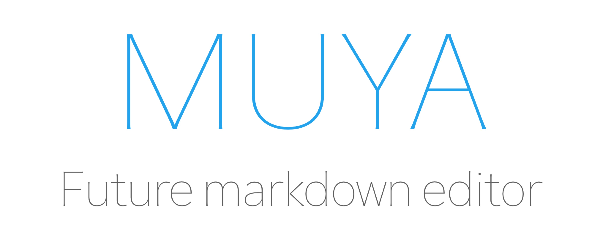

<p align="center"></p>

<p align="center"><b>Muya</b> — a standalone Markdown editor for the web, extracted from <a href="https://github.com/marktext/marktext">MarkText</a>.</p>

> Status: Muya is still under active development. APIs may change between minor versions and it is not yet recommended for production use.

## Features

- **CommonMark + GFM** blocks: paragraphs, ATX/Setext headings, bullet/ordered/task lists, code fences, tables, block quotes, horizontal rules, raw HTML, images. Parser baseline tracked against CommonMark 0.31 and GFM 0.29-gfm (see [`test/spec/conformance.md`](test/spec/conformance.md)).
- **Inline formats** with a floating toolbar, plus optional super/subscript, footnotes, front matter, and inline math.
- **Footnotes** end-to-end: `[^id]` references and `[^id]: …` definitions render with an interactive footnote tool and backref anchors on export.
- **Reference links and images**: `[text][ref]` / `![alt][ref]` resolve from `[ref]: url "title"` definitions on both render and round-trip.
- **Code block line numbers** — opt in with `codeBlockLineNumbers: true` to render gutters alongside fenced/indented code (and previewable blocks).
- **Diagrams & rich content**: [KaTeX](https://katex.org/) math, [Mermaid](https://mermaid.js.org/), [Vega/Vega-Lite](https://vega.github.io/), [PlantUML](https://plantuml.com/), and [Prism](https://prismjs.com/) syntax highlighting in code blocks.
- **Markdown ↔ HTML** round-trip via [`marked`](https://github.com/markedjs/marked) (read path) and [`turndown`](https://github.com/mixmark-io/turndown) + `joplin-turndown-plugin-gfm` (write path). `MarkdownToHtml` is exposed as a standalone utility; output passes through [DOMPurify](https://github.com/cure53/DOMPurify) (`sanitizeHyperlink` + `isValidAttribute`) for XSS-safe rendering.
- **Search and replace** with regex support, plus undo/redo history.
- **i18n** out of the box: 13 locales ship with the package — English, Simplified and Traditional Chinese, Japanese, Korean, Spanish, French, German, Portuguese, Italian, Dutch, Russian and Turkish.
- **JSON state model** built on [`ot-json1`](https://github.com/ottypes/json1) / [`ot-text-unicode`](https://github.com/ottypes/text-unicode) — wire it up to your own transport for collaborative editing.
- **TypeScript first** — types ship in the package, no extra `@types/*` install needed.

## Installation

```sh
npm install @muyajs/core
# or
pnpm add @muyajs/core
```

Muya is a browser library and expects a bundler (Vite, webpack, Rollup, esbuild, …). The package ships ESM (`lib/es`), CJS (`lib/cjs`), UMD (`lib/umd`), and full TypeScript declarations (`lib/types`).

## Quick start

```ts
import {
    CodeBlockLanguageSelector,
    EmojiSelector,
    FootnoteTool,
    ImageEditTool,
    ImageResizeBar,
    ImageToolBar,
    InlineFormatToolbar,
    LinkTools,
    Muya,
    ParagraphFrontButton,
    ParagraphFrontMenu,
    ParagraphQuickInsertMenu,
    PreviewToolBar,
    TableColumnToolbar,
    TableDragBar,
    TableRowColumMenu,
    zhCN,
} from '@muyajs/core';

import '@muyajs/core/lib/style.css';

// 1. Register the UI plugins you need (once, globally on the class).
Muya.use(EmojiSelector);
Muya.use(FootnoteTool);
Muya.use(InlineFormatToolbar);
Muya.use(ImageToolBar);
Muya.use(ImageResizeBar);
Muya.use(ImageEditTool, {
    imagePathPicker: async () => '/path/to/image.png',
    imageAction: async () => 'https://example.com/uploaded.png',
});
Muya.use(CodeBlockLanguageSelector);
Muya.use(LinkTools, {
    jumpClick: (linkInfo) => {
        const href = linkInfo?.href;
        if (href && /^https?:\/\//.test(href))
            window.open(href, '_blank', 'noopener,noreferrer');
    },
});
Muya.use(ParagraphFrontButton);
Muya.use(ParagraphFrontMenu);
Muya.use(ParagraphQuickInsertMenu);
Muya.use(TableColumnToolbar);
Muya.use(TableDragBar);
Muya.use(TableRowColumMenu);
Muya.use(PreviewToolBar);

// 2. Create the editor against an existing DOM node.
const container = document.querySelector('#editor') as HTMLElement;
const muya = new Muya(container, {
    markdown: '# Hello, Muya',
    footnote: true,
    codeBlockLineNumbers: true,
});

// 3. Optional: switch the UI language before init.
muya.locale(zhCN);

// 4. Boot. Nothing renders until init() runs.
muya.init();
```

A complete example, including a Vite project setup, lives under [`examples/`](./examples).

## Pasted link titles

Normal paste can turn a bare HTTP(S) URL into a link labeled with the page title.
Muya fetches and parses the HTML, decodes title entities, and falls back to the
URL if fetching fails or takes longer than 1.5 seconds. Plain-text paste skips
this lookup.

Browser fetching is subject to the host page's CSP and the target site's CORS
headers. Hosts can provide `fetchLinkHtml` to use their own HTTP transport or
backend proxy while leaving title parsing and paste behavior in Muya:

```ts
const muya = new Muya(container, {
    fetchLinkHtml: url => hostNetwork.fetchHtml(url),
});
```

The hook returns the HTML body, or an empty string for unsuccessful/non-HTML
responses. It should enforce its own request timeout and response size limit;
Muya's timeout stops waiting but cannot cancel a host request. MarkText supplies
this hook through its sandboxed preload bridge to the main process.

## API at a glance

The `Muya` instance returned from `new Muya(el, options)` exposes:

| Method | Purpose |
| --- | --- |
| `init()` | Mount the editor and instantiate registered UI plugins. |
| `locale(localeObject)` | Switch the UI locale. Use one of the bundled exports (`en`, `zhCN`, `zhTW`, `ja`, `ko`, `es`, `fr`, `de`, `pt`, `it`, `nl`, `ru`, `tr`) or supply your own. |
| `getMarkdown()` | Serialize the current document to Markdown. |
| `getState()` | Return a snapshot of the committed JSON document. |
| `flush()` | Commit pending edits before saving, exporting or switching documents. |
| `setContent(content, autoFocus?)` | Replace the document with Markdown (`string`) or `TState[]` and reset history. |
| `replaceContent(content, recordSelection?)` | Replace the document as one undoable history step. |
| `transact(fn)` | Complete a synchronous group of edits as one transaction. |
| `getSelection()` / `getSelectionState()` | Read the runtime selection or a serializable snapshot (text, image, table or `null`). |
| `setSelection(state)` | Restore a validated selection snapshot; returns whether it was accepted. |
| `undo()` / `redo()` | Step through the history stack. |
| `search(value, opts?)` | Run a search; `opts` includes `{ isRegexp, isCaseSensitive, isWholeWord, selectHighlight }`. |
| `find('previous' \| 'next')` | Move the active match. |
| `replace(value, { isSingle, isRegexp })` | Replace the active match or all matches. |
| `selectAll()` | Select the entire document. |
| `getTOC()` | Snapshot the current heading outline as `ITocItem[]` with `lvl`, `content`, `contentHtml`, `slug` and `githubSlug`. |
| `on(event, fn)` / `off(event, fn)` / `once(event, fn)` | Subscribe to editor events. |
| `destroy()` | Tear down the editor and free DOM listeners. |

Standalone utilities exported from the package root:

| Export | Purpose |
| --- | --- |
| `MarkdownToHtml` | Asynchronous Markdown → full HTML document (`await new MarkdownToHtml(md).generate()`). Requires a browser DOM for rendering. |
| `renderToStaticHTML(markdown, opts?)` | Synchronous Markdown → body HTML; diagrams remain code placeholders. Sanitizes by default; parser conformance tests opt out with `{ sanitize: false }`. |

Useful events emitted on the editor:

| Event | Payload |
| --- | --- |
| `json-change` | Completed change payload with `op`, `source`, `prevDoc` and `doc`; document snapshots can also be read through `getState()` and `getMarkdown()`. |
| `selection-change` | `{ selection, docChanged }`; selection is a runtime text/image/table union or `null`. Use `getSelectionState()` for persistence. |
| `focus` / `blur` | Fired when the contenteditable surface gains or loses focus. |

The full set of constructor options (font size, list defaults, math/footnote toggles, front matter delimiters, Mermaid/Vega themes, etc.) is described by `IMuyaOptions` in [`src/types.ts`](./src/types.ts); defaults live in `MUYA_DEFAULT_OPTIONS` in [`src/config/index.ts`](./src/config/index.ts).

## Bundled UI plugins

Plugins are floating tools/menus that you opt into with `Muya.use(Plugin, options?)`. They live under `src/ui/` and are exported from the package root:

| Plugin | What it does |
| --- | --- |
| `InlineFormatToolbar` | Bold / italic / link / etc. toolbar that follows the selection. |
| `EmojiSelector` | `:` trigger emoji picker. |
| `CodeBlockLanguageSelector` | Language picker inside fenced code blocks. |
| `ImageToolBar`, `ImageResizeBar`, `ImageEditTool` | Image-related affordances; `ImageEditTool` accepts `imagePathPicker` and `imageAction` callbacks for upload flows. |
| `ImagePathPicker` | Host-configurable image-path suggestions. |
| `TableChessboard` | Grid picker for new table dimensions. |
| `LinkTools` | Hover toolbar over native `<a>`, markdown links, and reference links. Takes a `jumpClick` callback to control jump-out behavior. |
| `FootnoteTool` | Floating popover for editing footnote definitions; requires the `footnote: true` editor option. |
| `ParagraphFrontButton`, `ParagraphFrontMenu` | The handle and menu that appear to the left of the active block. |
| `ParagraphQuickInsertMenu` | The `/` slash-command menu for inserting blocks. |
| `TableColumnToolbar`, `TableDragBar`, `TableRowColumMenu` | Table editing affordances. |
| `PreviewToolBar` | Tools shown over previewable blocks (math, Mermaid, etc.). |

`examples/src/main.ts` is the canonical reference for which plugins to register for a fully-featured editor.

## Architecture

```
Muya
├── EventCenter        custom pub/sub for editor-internal + user events
├── Editor             owns runtime modules and routes DOM events
│   ├── JSONState      committed ot-json1 document, source of truth
│   ├── EditTransactions batches edits, completes rules and commits history
│   ├── InlineEngine   inline parsing, projection, serialization and rendering
│   ├── Selection      live selection bridged to the JSON path
│   ├── Search         regex search + highlight overlay
│   ├── Clipboard      paste/copy bridging via turndown / marked
│   ├── History        OT-aware undo/redo stack
│   └── ScrollPage     root block of the tree
├── Ui                 registry of floating tools/menus (toolbars, pickers)
└── I18n               locale dispatcher
```

The block tree under `ScrollPage` is built from `TreeNode → Parent → (Content | Format)`. Each concrete block lives in `src/block/{commonMark,gfm,extra,content}/` and is registered in `src/block/index.ts::registerBlocks()`. Markdown serialization is handled in `src/state/{markdownToState,stateToMarkdown,markdownToHtml,htmlToMarkdown}.ts`.

Inline edits use `ot-text-unicode` operations nested inside `ot-json1` operations. A collaborative host must supply transport, operation transformation and synchronization; the package does not provide a complete collaboration service.

Pending edits commit through `EditTransactions`. Call `muya.flush()` before reading content for persistence or switching documents. `muya.transact(fn)` groups synchronous edits into one command; nested scopes share its undo boundary, and an exception rolls back the scope. Complete asynchronous work before entering a transaction. See [`src/editor/transactions/index.ts`](src/editor/transactions/index.ts).

Runtime selections contain live blocks and DOM nodes. Persist `getSelectionState()` snapshots and restore them with `setSelection()`. Text offsets use UTF-16 code units, image ranges are half-open source ranges, and table coordinates are zero-based including the header. See [`src/selection/types.ts`](src/selection/types.ts).

For a deeper, file-level walkthrough see [`AGENTS.md`](./AGENTS.md).

## Project structure

Muya lives in `packages/muya` in the MarkText pnpm workspace:

```text
packages/muya/
├── src/              @muyajs/core implementation and co-located unit tests
├── test/spec/        CommonMark and GFM conformance fixtures and runners
├── examples/         muya-examples — Vite demo, imports core via workspace:*
├── e2e/              muya-e2e — Playwright host and browser tests
├── docs/             Logo
└── AGENTS.md         Architecture and package conventions
```

The package declares Node ≥20.19; the containing workspace requires Node ≥22.12
and pnpm ≥10. Use the pnpm version pinned in the root `package.json`. The library
build target is `chrome70`.

## Development

Run from the MarkText repository root:

```sh
pnpm install
pnpm --filter muya-examples dev:demo
```

Root `pnpm dev`, `pnpm build` and `pnpm test` target the desktop application.
Use package-specific commands for Muya:

| Command | What it runs |
| --- | --- |
| `pnpm --filter @muyajs/core build` | TypeScript and Vite library build, emitting `lib/{es,umd,cjs,types}`. |
| `pnpm --filter @muyajs/core build:types` | Emit declarations for desktop type checking. |
| `pnpm --filter @muyajs/core test` / `coverage` | Co-located Vitest unit tests, optionally with coverage. |
| `pnpm --filter @muyajs/core test:spec` | CommonMark and GFM conformance suites with expected-failure baselines. |
| `pnpm --filter @muyajs/core lint` / `lint:fix` | ESLint (antfu config) over `src test`. |
| `pnpm --filter @muyajs/core lint:types` | `tsc --noEmit`. |
| `pnpm --filter @muyajs/core lint:css` | Stylelint over source CSS. |
| `pnpm --filter @muyajs/core check-circular` | Madge against the public entry point; enforced in CI. |
| `pnpm --filter muya-e2e e2e:chromium` | Chromium browser tests; see [E2E instructions](e2e/README.md). |

Follow the root [contributing guide](../../.github/CONTRIBUTING.md). The root
Husky pre-commit hook runs lint-staged.

## Build

```sh
pnpm --filter @muyajs/core build
```

Vite produces `lib/es/index.js`, `lib/umd/index.js` and `lib/cjs/index.js`;
`vite-plugin-dts` emits declarations to `lib/types/`. `publishConfig.exports`
in the package's `package.json` describes published output. Its development
`exports` map points at `src/index.ts`, allowing the desktop, demo and E2E host
to import workspace TypeScript directly.

## Publishing

`@muyajs/core` is not published from this repository; marktext consumes it in-workspace through the source `exports` map. Release management lives in the upstream muya repository: <https://github.com/marktext/muya>.

## FAQ

**What is the relationship between MarkText and Muya?**

Muya is derived from MarkText. The team's goal is for Muya to live outside the desktop app so it can power web editors as well; the Electron-specific assumptions have been progressively peeled away.

**Does the Muya version track MarkText's version?**

No, the two version numbers are independent.

## Built with Muya

- [MarkText](https://github.com/marktext/marktext) — next-generation Markdown editor for macOS, Windows, and Linux.
- [MindBox](https://www.mindbox.cc/) — note-taking app with first-class Markdown support.

## License

[MIT](../../LICENSE) © [Jocs](https://github.com/Jocs)
